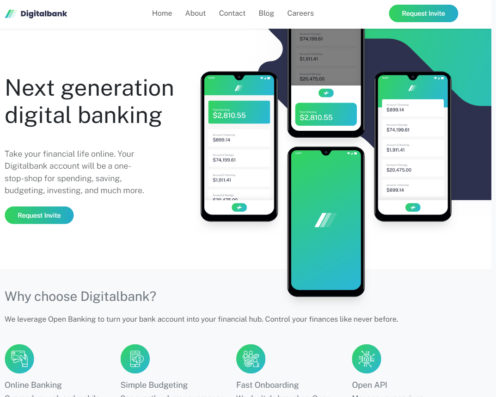
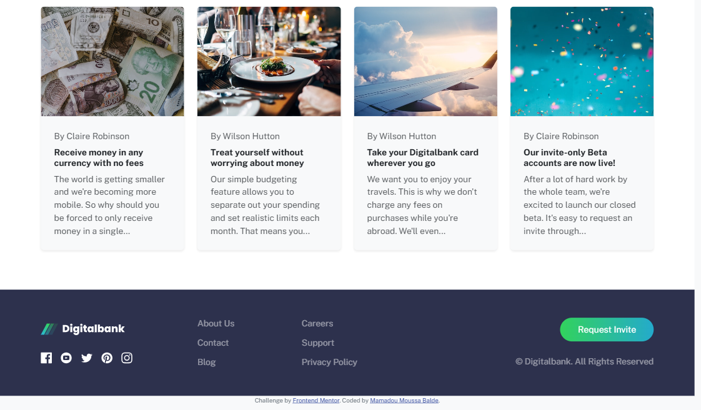
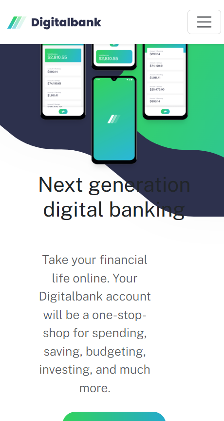
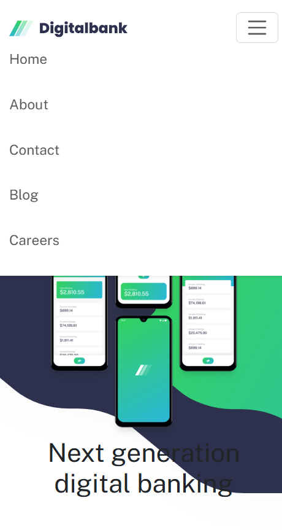

# Digitalbank

A landing page for Digitalbank.

## Description

The browser tab title is **Frontend Mentor | Digitalbank landing page**. The font is Public Sans at 18px. Bootstrap 5 supplies the navbar, the grid, and the collapse menu. The custom styles are in the page itself.

Every link on the page uses `href="#"`, except the Frontend Mentor credit. Home, About, Contact, Blog, Careers, the article titles, Request Invite, the logo, and the social icons all stay on this page.

The heading is “Next generation digital banking.” Above 992px a line break sits after “generation.” The paragraph reads: “Take your financial life online. Your Digitalbank account will be a one-stop-shop for spending, saving, budgeting, investing, and much more.”

Request Invite is a pill with a gradient from green `hsl(136, 64%, 51%)` to cyan `hsl(192, 70%, 47%)`. The stylesheet sets its hover opacity to 0.85. Nav links and footer links turn that same green on hover.

The phone image alt text is “Digitalbank mobile mockups.” Below 576px that image is above the text. From 576px up, the text is on the left and the phones are on the right. The hero background is `bg-intro-mobile.svg` until 992px, then `bg-intro-desktop.svg`.

“We leverage Open Banking to turn your bank account into your financial hub. Control your finances like never before.”

| Feature | Text |
| --- | --- |
| Online Banking | Keep track of your finances wherever you are in the world. |
| Simple Budgeting | See where your money goes and get a notice near your limits. |
| Fast Onboarding | “We don’t do branches.” Open an account online in minutes. |
| Open API | Savings, investments, pension, and more from one account. |

On a wide screen these are four columns. At the medium Bootstrap width they are two columns. At 375px they stack.

| Author | Title |
| --- | --- |
| Claire Robinson | Receive money in any currency with no fees |
| Wilson Hutton | Treat yourself without worrying about money |
| Wilson Hutton | Take your Digitalbank card wherever you go |
| Claire Robinson | Our invite-only Beta accounts are now live! |

Each summary ends with an ellipsis. The titles are links that stay on this page. The cards are one column on a narrow screen, two from the medium breakpoint, and four from the large breakpoint.

The footer background is dark blue `hsl(233, 26%, 24%)`. It repeats the light logo, Facebook, YouTube, Twitter, Pinterest, and Instagram, then About Us, Contact, Blog, Careers, Support, and Privacy Policy. Request Invite is on the right on a wide screen. The line under it is `© Digitalbank. All Rights Reserved`.

Under the footer:

```text
Challenge by Frontend Mentor. Coded by Mamadou Moussa Balde.
```

Frontend Mentor links to `https://www.frontendmentor.io?ref=challenge`. The name link stays on this page.

At 1280px the nav is a row and Request Invite sits in the header. At 375px the menu button replaces the nav links and the phones sit above the heading. The open menu lists Home, About, Contact, Blog, and Careers. Request Invite is not in that menu. The header button is hidden below 992px. The hero button and the footer button stay on the page.

## Screenshots

### Wide layout



### Articles and footer



### 375px wide



### Open menu



## Getting Started

### Dependencies

* A browser
* A network connection, because Bootstrap and Public Sans load from a CDN

### Installing

No install step.

### Executing program

Open `index.html` in a browser, or serve this folder:

```bash
python -m http.server
```

The menu button is the layout below 992px. At 992px and above the links and the header Request Invite are in the bar.

## Help

Every link uses `href="#"` except the Frontend Mentor credit, so those links stay on this page. Request Invite is not in the collapsed menu. The header button is hidden below 992px.

## Authors

[Mamadou Moussa Balde](https://www.linkedin.com/in/2mb/)

Frontend Mentor: [@baldemoussa](https://www.frontendmentor.io/profile/baldemoussa)

## Version History

* Current page
    * Reviewed at 1280px and at 375px
    * Open menu lists Home, About, Contact, Blog, and Careers

## License

This folder does not include a `LICENSE.md` file.

## Acknowledgments

* [Frontend Mentor](https://www.frontendmentor.io?ref=challenge)
* [Bootstrap 5](https://getbootstrap.com/docs/5.3/getting-started/introduction/)
* [Public Sans](https://fonts.google.com/specimen/Public+Sans)
* [README template](https://gist.github.com/DomPizzie/7a5ff55ffa9081f2de27c315f5018afc)

## Reflection

### What I learned

This project allowed me to solidify my understanding of building responsive layouts using a combination of vanilla CSS and a utility-first framework like Bootstrap 5. I particularly focused on implementing the custom gradient buttons and managing the absolute positioning of the hero images to match the design.

```css
.btn-gradient {
  background: linear-gradient(to right, var(--primary-green), var(--primary-cyan));
  color: #fff !important;
  border: none;
  border-radius: 50px;
  padding: 0.6rem 2rem;
}
```

### Continued development

In future projects, I want to focus on refining my CSS architecture to make it more scalable and maintainable. I also want to improve the accessibility of my interactive components, ensuring appropriate ARIA roles and keyboard navigation.

### Useful resources

* [Bootstrap 5 Documentation](https://getbootstrap.com/docs/5.3/getting-started/introduction/) was essential for quickly implementing grid layouts and responsive navigation.
